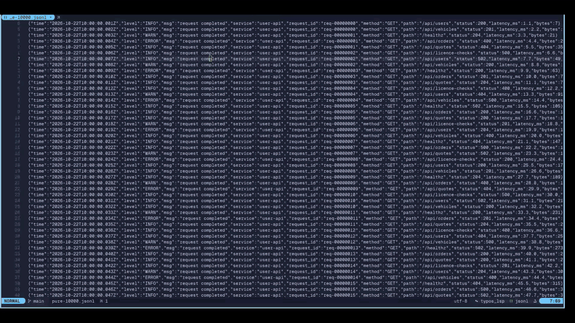

# jlog.nvim

Read JSON server and container logs in Neovim. Logs pulled from servers, containers and CI are often unformatted, one
giant line, and double-encoded.



## Features

- **Any JSON log:** JSONL, JSON arrays and timestamped log exports; double-encoded JSON is unwrapped, and nothing is
  dropped or reformatted.
- **Readable view:** one compact line or indented JSON per entry, searchable with `/` and `:g`.
- **Filter and group:** a small query language (`status>=500 -health`), group by any field, and top values per field
  in the sidebar.
- **Big and live files:** the first screen of a 500k-line file in about 100ms, and the view follows the file as it
  grows.
- **Customizable:** field styles, sidebar, keymaps and highlights.

## Requirements

- Neovim >= 0.10 (`:checkhealth jlog` confirms it)

## Installation

With [lazy.nvim](https://github.com/folke/lazy.nvim):

```lua
{ "kcayme/jlog.nvim", opts = {} }
```

`setup()` is optional; without it jlog runs with the defaults below.

## Quick start

1. Open a log file and run `:JLog` (or `:JLog path/to/app.log`). It opens in its own tab, with the sidebar on the right.
2. Press `<CR>` on an entry to expand it, `E` to expand them all.
3. In the sidebar, type `status>=500` under `FILTERS`, or `request_id` under `GROUP BY`, then `:w`.
4. Or press `<CR>` on values in `FIELDS` to filter by them (one line each, `OR` between values of a field), `g` on a
   field to group by it.
5. `?` in the sidebar lists every key; `q` closes the workspace.

## Usage

### Opening logs

`:JLog` opens the current buffer, `:JLog {path}` a file; the format is detected on open. jlog never writes to the
source file, and `gf` on an entry shows its raw source text.

### The log view

Entries are shown newest first, for JSONL files and timestamped exports alike; `R` reverses the order and
`view.sort = "asc"` makes oldest first the default. `<CR>` expands an entry in place, `E` switches the whole view
between compact and expanded, `]]` / `[[` move between entries and `]e` / `[e` between errors. The winbar shows how
many entries match and the active filters and group.

### The sidebar

- **FILTERS** and **GROUP BY** are typed in the buffer and applied with `:w`, by leaving insert mode, or as you type
  with `sidebar.auto_apply`. One filter clause per line, ANDed; an empty section shows an example.
- **LIMIT** has two labelled lines, applied with `:w` too: a number after `entries` shows the first N entries in
  display order (it follows SORT), and one after `groups` the first N groups of a GROUP BY. With both, the last group
  can be cut short. The labels cannot be edited; leave a value blank for no limit. FIELDS still counts every match.
- **SORT** shows the current order. It is not part of the buffer, so it cannot be edited; `R` reverses it.
- **FIELDS** lists every field with its top values and counts: `<CR>` on a value adds it as a filter, `g` on a field
  groups by it. After a filter or group, the lines show first and the counts follow, dimmed and marked `counting…`
  until they arrive. Counts for fields with more than 1000 distinct values are estimates, marked `~`.

`S` hides or shows the sidebar (nothing is counted while it is hidden), `s` focuses it. Its sections, their order and
how FIELDS lists and styles field names are configurable: see `sidebar` under [Configuration](#configuration).

### Large files

Large JSONL files are parsed on background threads: the first screen shows right away and the rest loads in the
background, with FIELDS adding fields as they are found (`loading N%`); a timestamped export that has to be reordered
first appears once it has loaded. A log larger than `paging.size` (100k lines or array elements) is shown one page at a
time, so only that page is held in memory: the winbar and sidebar show `page 2/5`, `]p` / `[p` or `:JLog page {n}` move
between pages, and each page also shows `paging.overlap` lines of its neighbours, dimmed, so a request at a page edge
stays whole. Filters, group and mode carry over to another page. A filter applies to the page shown, and every page is
counted in the background: the winbar shows the total (`55 in all`), the sidebar's PAGE section the matches on each
page, and `]m` / `[m` jump to the next or previous page with matches. Once counted, the view shows the matches of every
page in one view, with FIELDS and GROUP BY over all of them, so a request whose lines cross a page edge reads whole; a
filter matching more than `paging.size` entries stays on its page. `A` (or `:JLog scope page|all`) switches between that
view and the page holding the cursor entry, and keeps the choice for later filters; set `paging.filter_scope = "page"`
to filter one page at a time by default.

While a large page is still being drawn, `/` may match the raw text of rows not drawn yet; it is exact once drawing
is done.

### Live reload

The view follows the file: appended lines stream in, and atomic saves, rotation and a file deleted and created again
are followed. A rewritten file returns to the page holding the entry under the cursor.

### Progress messages

Work that outlasts the first screen (loading, indexing pages, applying a filter or group, rendering) reports one
message when it starts and one when it is done. On Neovim 0.12+ these are progress messages, so a notification plugin
that draws progress can show a spinner; on older versions they go through `vim.notify`. `progress = "notify"` always
uses `vim.notify`, `progress = "off"` turns them off.

### Commands

| Command | Action |
|---------|--------|
| `:JLog` | Open a workspace for the current buffer (no-op if one is already open in this tab). |
| `:JLog {path}` | Open a log file. |
| `:JLog filter {clause}` | Add a filter clause (see below). |
| `:JLog filter` | Clear all filter clauses. |
| `:JLog group {field}` | Group entries by a field. |
| `:JLog group` | Clear grouping. |
| `:JLog page {n}` | Go to page `n` of a paged log. |
| `:JLog scope all\|page` | Show the filter matches of every page in one view, or go back to a page. |
| `:JLog raw` | Open the source in a new tab. |
| `:JLog close` | Close the workspace. |

### Keymaps

Buffer-local, configurable under `keymaps`; set any to `false` to disable it.

| Key | Where | Action |
|-----|-------|--------|
| `<CR>` | log view | Expand/collapse the entry under the cursor, keeping its compact line on top |
| `E` | log view | Toggle the whole view between compact and expanded |
| `gf` | log view | Show the entry's raw source text in a float (press again in the float to jump to the source line, JSONL only) |
| `R` | log view, sidebar | Reverse order |
| `X` | log view, sidebar | Clear filters, group and limits |
| `]]` / `[[` | log view | Next / previous entry |
| `]e` / `[e` | log view | Next / previous ERROR-level entry |
| `]p` / `[p` | log view | Next / previous page of a paged log |
| `]m` / `[m` | log view | Next / previous page with filter matches |
| `A` | log view | Filter matches of every page in one view; again to go back to a page |
| `s` | log view | Focus the sidebar |
| `S` | log view, sidebar | Toggle the sidebar |
| `q` | log view, sidebar | Close the workspace (closes the float in the raw popup) |
| `<CR>` | sidebar | On a field value, add it as a filter line (`OR` after the field's other values, else `AND`); again to remove it |
| `g` | sidebar | On a field, group by it |
| `s` | sidebar | On a field, hide it from compact lines, or show it again |
| `?` | sidebar | Open a guide to these keys (`? help` on the sidebar's first line) |

### Filter syntax

One clause per `:JLog filter` call or sidebar `FILTERS` line. Every line after the first starts with its operator:
`AND` starts a new condition that must also match, `OR` adds an alternative to the condition above. A line typed
without one is taken as `AND`, and the operator is written in when the filter applies.

```
service=user-api
AND request_id=req-00000001
OR request_id=req-00000002
```

This reads as `service=user-api AND (request_id=req-00000001 OR request_id=req-00000002)`.

```
:JLog filter status>=500 path=/api/licence-checks
```

| Syntax | Meaning |
|--------|---------|
| `field=value`, `field!=value` | Equality on the value's text; numbers also compare numerically (`status=500`). |
| `field>n`, `>=`, `<`, `<=` | Numeric comparison; non-numeric values never match. |
| `time>=2026-10-22T10:00`, `<`, ... | Time comparison when the value is a date (`2026-10-22`), a date and time, or a full ISO time; fields holding ISO 8601 times compare as instants, whatever their offset. |
| `field~regex` | Vim regex (same flavor as `/`, honors `'ignorecase'`) against the field's string form. |
| `value` | Bare term: Vim regex against the entry's raw source text. |
| `-term` | Negate a term. |
| `term term`, `term AND term` | Inside a line, a space or `AND` means AND. |
| `a OR b` | Uppercase `OR` separates alternatives; AND binds tighter. |
| `"quoted value"` | Needed for spaces or the words `OR` and `AND`, e.g. `msg="request completed"`, `"AND"`. |

- Fields are dotted paths (`req.headers.host`). `time`, `level` and `msg` resolve through the configured `fields`
  aliases (e.g. `message`, `severity`); `level` compares case-insensitively.
- A missing field never matches, so `-term` matches it. Filtering while grouped keeps whole groups.
- A condition made only of `field=value` alternatives on one field (picked values on `OR` lines, or
  `status=500 OR status=502`) leaves that field's FIELDS counts as if it were off, so all its values stay listed to
  pick from; the other fields count only the matches.
- In field names a newline is written `\n` and a backslash `\\`. Inside quotes only `\"`, `\\` and `\n` are
  escapes, so a quoted `~` regex that needs a literal backslash writes `\\\\` (`msg~"a\\\\b"` matches `a\b`).
- A typed time without a zone is local time, like the view shows (UTC with `view.time_utc`); a date alone is
  midnight. Quote one with a space: `time<"2026-10-22 11:00"`. `=` and `~` still match the time's text.
- Integers are exact at any size: `id=12345678901234567890` works. `>`, `>=`, `<` and `<=` compare as doubles, so
  past 2^53 they are approximate.

## Configuration

Defaults (all optional):

```lua
require("jlog").setup({
  fields = {
    time = { "time", "ts", "timestamp", "@timestamp", "time_stamp", "timeStamp" },
    level = { "level", "lvl", "severity" },
    message = { "msg", "message" },
    status = { "status", "status_code" }, -- class-colored (2xx-5xx) when styled inverted/pill
  },
  compact = {
    style = "plain", -- "plain" | "inverted" | "pill"; level defaults to "inverted"
    order = {}, -- top-level keys shown first, e.g. { "method", "path", "status" }
    fields = {}, -- per key or role: { style = "pill", format = function(ctx) return ctx.value end }
    pill = { left = "\238\130\182", right = "\238\130\180" }, -- Nerd Font caps; "" for square ends
    style_values = { "level", "status" }, -- keys or roles styled on the value instead of the key
  },
  view = {
    mode = "compact",
    sort = "desc", -- "desc" shows the newest entries first
    field_colors = true,
    -- os.date format for compact-line times (%L is milliseconds), false for HH:MM:SS.mmm as written, or a function:
    -- function(t) return t.value end shows the time unformatted
    time_format = "%Y-%m-%d %H:%M:%S",
    time_utc = false, -- show time_format times in UTC instead of local time
    ignore_fields = {}, -- field paths left out of compact lines, e.g. { "hostname", "req.headers" }
  },
  unwrap = { enable = true, max_depth = 4 },
  sidebar = {
    width = 45,
    position = "right",
    line_numbers = false, -- show line numbers in the sidebar
    -- apply FILTERS, GROUP BY and LIMIT edits without :w, once edits pause for debounce_ms
    auto_apply = { enable = false, debounce_ms = 600 },
    fields = { -- how FIELDS lists and styles field names
      colors = true, -- false: every name uses JLogFieldName
      style = "plain", -- "plain", "inverted" or "pill", like compact fields
      pill = { left = "\238\130\182", right = "\238\130\180" }, -- Nerd Font caps; "" for square ends
      -- per field path or role, e.g. { level = { style = "pill" } }; a format(ctx) gets ctx.name and ctx.distinct
      -- and returns the name's text and optionally a highlight group
      styles = {},
      pinned = {}, -- field paths or roles listed first, e.g. { "level", "status", "path" }
      -- the other fields: "alphabetical", or "count" (in the most entries first; applied once the counts are final,
      -- so rows hold still while a file loads)
      sort = "alphabetical",
    },
    -- sections in the order shown, e.g. { "fields", "filters", "group" }; one left out is hidden, and :w then keeps
    -- the filters or group that field actions and commands set
    sections = { "sort", "page", "filters", "group", "limit", "fields" },
  },
  facets = { top_values = 10 },
  -- size and overlap: source lines (JSONL) or array elements
  paging = { size = 100000, overlap = 2000, filter_scope = "all" },
  progress = "auto", -- "auto" (progress messages on Neovim 0.12+), "notify" (always vim.notify) or "off"
  keymaps = {
    toggle_entry = "<CR>",
    toggle_mode = "E",
    raw = "gf",
    reverse = "R",
    clear = "X",
    next_entry = "]]",
    prev_entry = "[[",
    next_error = "]e",
    prev_error = "[e",
    next_page = "]p",
    prev_page = "[p",
    next_match_page = "]m",
    prev_match_page = "[m",
    toggle_scope = "A",
    focus_sidebar = "s",
    toggle_sidebar = "S",
    close = "q",
    add_filter = "<CR>",
    group_by = "g",
    ignore_field = "s",
    help = "?",
  },
})
```

See [docs/options.md](docs/options.md) for every option.

### Compact line formatting

Each field of a compact line has a style, set globally with `compact.style` or per field with
`compact.fields[key].style` (`key` is a field name or a role: `time`, `level`, `message`, `status`):

- `plain`: `key=value`, the key colored per field. Example: `method=GET`.
- `inverted`: the key as a colored block. Example: ` method =GET`.
- `pill`: like `inverted`, with rounded caps around the key. Example: `(method)=GET`.

Fields in `compact.style_values` (by default `level` and `status`) are styled on the value instead (` 500 `, no key);
remove one to give it a styled key. `level` is `inverted` by default, colored by its level; a styled status value takes
its class color (`JLogStatus2xx` ... `JLogStatus5xx`); other fields take their key's color. `time` and `message` stay
plain unless styled through `compact.fields`.

`compact.order` lists top-level keys to show first. `compact.fields[key].format(ctx)` replaces a field's text: `ctx`
has `value`, `key` and `entry`, and it returns the text and optionally a highlight group. It runs on every drawn
line; if it errors, the default text is used and jlog warns once per field.

```lua
compact = {
  order = { "method", "path", "status" },
  fields = {
    method = { style = "pill" },
    duration_ms = {
      format = function(ctx)
        return ctx.value .. "ms", (tonumber(ctx.value) or 0) > 500 and "DiagnosticError" or nil
      end,
    },
  },
}
```

Pill caps are inline virtual text (never yanked or searched) and need a Nerd Font; `pill = { left = "", right = "" }`
gives square ends.

### Statusline plugins

The log view shows its counts and filters in the winbar. A statusline plugin that draws winbars, such as lualine with
a `winbar` section, replaces it; exclude jlog's filetypes `jlog` and `jlog_sidebar`:

```lua
require("lualine").setup({
  options = { disabled_filetypes = { winbar = { "jlog", "jlog_sidebar" } } },
})
```

## Highlight groups

All groups are defined with `default = true` and re-applied on `ColorScheme`. Level groups are badges: the
linked group's color, reversed and bold, so the level reads as a colored label in compact lines. Override them with
`vim.api.nvim_set_hl(0, "JLogLevelError", { ... })` or `:hi`.

| Group | Used for | Default link |
|-------|----------|--------------|
| `JLogTime` | timestamp in compact lines | `Comment` |
| `JLogLevelError` | ERROR / FATAL / PANIC | badge: `DiagnosticError` color as background |
| `JLogLevelWarn` | WARN / WARNING | badge: `DiagnosticWarn` color as background |
| `JLogLevelInfo` | INFO | badge: `DiagnosticInfo` color as background |
| `JLogLevelDebug` | DEBUG | badge: `DiagnosticHint` color as background |
| `JLogLevelTrace` | TRACE and unknown levels | badge: `Comment` color as background |
| `JLogStatus2xx` | status field with a 2xx value, in compact lines | `DiagnosticOk` |
| `JLogStatus3xx` | status field with a 3xx value | `DiagnosticInfo` |
| `JLogStatus4xx` | status field with a 4xx value | `DiagnosticWarn` |
| `JLogStatus5xx` | status field with a 5xx value | `DiagnosticError` |
| `JLogBadge*` | derived on first use: a color group's color reversed and bold, for `inverted` and `pill` fields (e.g. `JLogBadgeJLogStatus2xx`) | none; redefined on `ColorScheme` |
| `JLogMessage` | message text | `Normal` |
| `JLogKey` | `key=` in compact, object keys in expanded, when `view.field_colors = false` | `Identifier` |
| `JLogField1` … `JLogField8` | keys and FIELDS names, one color per field in first-seen order, cycling | the first distinctly colored of `Identifier`, `Function`, `Type`, `Constant`, `Special`, `Statement`, `PreProc`, `Character`, `Label`, `Keyword`, `Tag`, `Directory`, skipping any colored like a value (`JLogValue`, `JLogString`, `JLogNumber`, `JLogBoolean`, `JLogNull`) |
| `JLogValue` | compact values | `String` |
| `JLogString` | expanded string values | `String` |
| `JLogNumber` | expanded number values | `Number` |
| `JLogBoolean` | expanded boolean values | `Boolean` |
| `JLogNull` | expanded null values | `Constant` |
| `JLogPrefix` | text before embedded JSON | `Comment` |
| `JLogPlain` | non-JSON entries and continuation lines | `Comment` |
| `JLogGroupHeader` | group headers (virtual lines and closed group folds) | `Title` |
| `JLogSectionHeader` | sidebar `FILTERS` / `GROUP BY` / `LIMIT` / `SORT` / `FIELDS` | `Title` |
| `JLogFieldName` | field names in the FIELDS section, when `sidebar.fields.colors = false` | `Identifier` |
| `JLogFieldCount` | counts in the FIELDS section | `Comment` |
| `JLogFieldStale` | FIELDS counts kept from the last apply while new ones are counted | `NonText` |
| `JLogFieldIgnored` | FIELDS names of fields hidden from compact lines | `NonText` |
| `JLogFilterInvalid` | The "invalid filter" note beside FILTERS while a filter line fails to parse | `DiagnosticWarn` |
| `JLogHint` | sidebar examples on empty FILTERS / GROUP BY / LIMIT lines, `:w to apply`, and the SORT order | `Comment` |
| `JLogWinbar` | jlog winbar text | `WinBar` |
| `JLogOverlap` | entries a page shares with its neighbours | `Comment` |

## Benchmark

On 10k to 500k-line JSONL files, jlog's load is compared with `jq` and `vim.json.decode`, and opening, searching,
filtering and grouping are timed in a workspace; see [bench/results.md](bench/results.md). `make bench` regenerates it
(jq is needed for its column).
